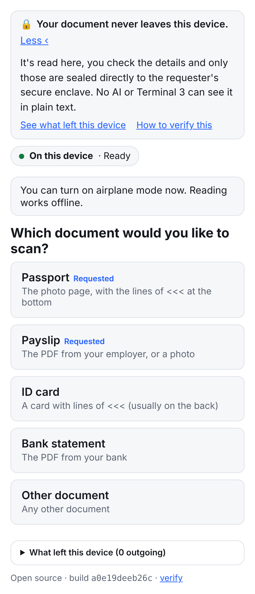
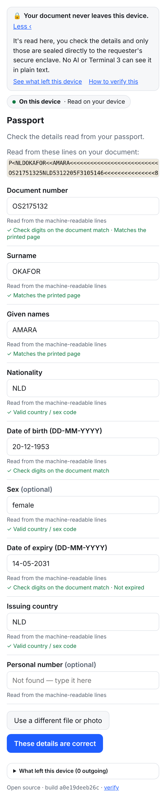
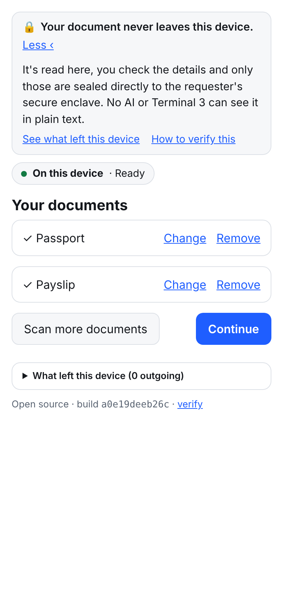
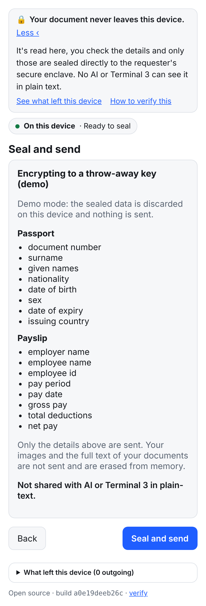
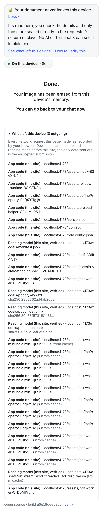

# Private Doc Scanner

**Open-source document scanner for AI: reads your passport, payslip or bank statement on your own phone and saves it to your own hardware sealed vault, so your AI can use it without seeing it.**

   

Asking Claude or ChatGPT to "read this payslip" sends the whole document to the model provider. Private Doc Scanner reads it on your device instead, checks what it read, lets you confirm every field, and seals only those details to **your own Terminal 3 vault**. From there you can finally run fully autonomous transactions with your AI without it actually seeing or touching your sensitive data.

| Start | Review | Your documents | Seal | Done |
|---|---|---|---|---|
|  |  |  |  |  |

## Try it

1. **Scan, no account needed.** Open the scanner on your phone, pick a document type, and upload a file or take a photo. It's read on the device and you see what it extracted, with the checks it ran. Nothing is sent anywhere.
2. **Let your AI use it.** At "Seal and send", sign in with your email and the code it sends. First time, the scanner sets up your private vault (about 1,100 test credits on T3N testnet, once) and seals what you reviewed into it.
3. **Connect your AI.** Paste the prompt below into Claude Code or Codex. Your assistant installs the T3N SDK, connects to your vault, and remembers the setup for next time.

### Setup prompt (Claude Code)

```text
Set me up with Private Doc Scanner and Terminal 3 (T3N) so my private documents stay out of AI chats
and I can use them in my own workflows. Run the commands yourself.

Ground rules, now and in future sessions:
- My T3N API key is in the environment as T3N_API_KEY (or a git-ignored .env). Never ask me to paste it,
  never print it, never put it in code, git or memory.
- Private documents go through the scanner link only; never ask me to upload or paste them.

Steps:
1. Check Node.js 22+.
2. Clone https://github.com/Terminal-3/private-doc-scanner into ~/t3n-workspace, then in its starter/
   folder run npm install and npx tsx scripts/setup-vault.ts. Show me my did:t3n and my vault name.
3. Run npx tsx scripts/new-link.ts <the document types I want> and give me the link to open on my phone.
4. Draft a "Terminal 3 (T3N)" section for ~/.claude/CLAUDE.md (use T3N for private data; workspace path;
   key from env only; my DID and vault; the new-link and vault status/evaluate commands), show it to me,
   and save it only after I say yes. Copy the repo's .claude/skills into ~/.claude/skills.
5. Ask me what I want to build first.
```

For Codex, use the same prompt and save the memory section to `~/.codex/AGENTS.md`. The repo's own [`CLAUDE.md`](CLAUDE.md), [`AGENTS.md`](AGENTS.md) and [skills](.claude/skills) tell coding agents how to use it.

## FAQ

### How do I use my passport, payslip or bank statement with AI without uploading it?
Scan it here instead of attaching it to a chat. It's read on your device, you review the details, and only those are sealed to your T3N vault. Your AI then asks the vault questions and gets yes-or-no answers.

### Is it safe to paste my documents into ChatGPT or Claude?
Anything you attach or paste goes to the model provider. If the document is private, keep it out of the chat: scan it here and let the AI work with the vault instead.

### How can an AI agent check my income or ID without seeing it?
The vault runs checks inside a secure enclave (Intel TDX) on T3N, such as "net pay at least 3,000", "document not expired" or "nationality is one of …", and returns pass or fail plus which fields were verified on the document. Values are never returned.

### Where should I keep API keys and secrets for an app I'm building with AI?
In your tool's secret settings or a git-ignored `.env`, never in a chat. The setup prompt above follows that rule and tells your assistant to keep following it.

### Does my document ever leave my device?
No. The file is read into memory on your device and never uploaded. Only the details you confirm leave, encrypted to a T3N enclave whose hardware attestation is verified first. "What left this device" lists every request the page made.

### Do I need an account to try it?
No. Scanning and reviewing work without one. You need a T3N account (email and a code) only to save the result to your vault.

## What it checks

| Check | Where it applies |
|---|---|
| ICAO 9303 MRZ check digits, plus the printed page cross-checked against the MRZ | Passports and ID cards |
| Gross − deductions = net | Payslips |
| Opening + money in − money out = closing; running balances | Bank statements |
| IBAN mod-97, valid dates, not expired | Wherever those fields appear |

A field is marked verified only by a deterministic check like these. The benchmark fails CI if any verified field is wrong.

## Guarantees (and how they are enforced)

| Promise | Enforced by |
|---|---|
| The document never leaves the device | Files are read into memory from the picker or camera and never uploaded. CSP `connect-src 'self' <destination>`. e2e test: no request body or URL contains document values. |
| Only reviewed fields leave, encrypted | `pde.submission/v1` carries values plus provenance only: no images, page text or file names. Sealed by `@terminal3/t3n-sdk` (ML-KEM session) or HPKE (RFC 9180). e2e test decrypts it. |
| Encrypted only to a genuine enclave | `handshake()` verifies the Intel TDX attestation against an operator-signed trust manifest **before** sending. If that fails, Send is disabled (e2e test with a forged manifest). |
| Stored in a vault you own | Each user's data goes to a contract registered under their own DID (`z:<their tid>:doc-intake`), with private maps only that contract can read. The page shows whose vault it is before sealing. |
| You can check what left | "What left this device" lists the browser's own record of every request, including the OCR worker's. Any unexpected origin blocks submission. |
| Works offline | Self-hosted, hash-pinned models plus a service worker. e2e test reads a passport with the network turned off. |

Full threat model and limits: [docs/privacy-model.md](docs/privacy-model.md).

## Accuracy

Synthetic documents, `pnpm bench` (Node, ONNX Runtime WASM, PP-OCRv4 mobile), 20 documents per scenario:

| Scenario | Field accuracy | Docs fully correct | Auto-accepted fields correct | Fields flagged for review | Verified but wrong | Median time (Node, 1 thread) |
|---|---|---|---|---|---|---|
| Payslip PDF (digital) | 100% | 100% | 100% | 0% | **0** / 60 | 15 ms |
| Bank statement PDF (digital) | 100% | 100% | 100% | 0% | **0** / 100 | 11 ms |
| Passport photo (clean) | 99.4% | 95% | 100% | 3% | **0** / 155 | 5.9 s |
| Passport photo (phone-like: ±3° tilt, noise, blur) | 83.1% | 65% | 100% | 31% | **0** / 108 | 5.3 s |
| Payslip photo (phone-like) | 87.5% | 60% | 100% | 72% | **0** / 39 | 3.6 s |

Digital PDFs are exact because no OCR is involved. Photos are harder; anything not vouched for by a check is highlighted for you. Known weak spots: handwriting, non-Latin scripts (the default model reads CJK and Latin), heavy glare, and complex multi-page tables.

## Runs on most phones

The reading engine is picked at runtime: PP-OCRv4 on WebGPU on recent desktops and Android, PP-OCRv4 on WASM on Safari and iPhone, and Tesseract on low-memory devices. Text-layer PDFs are read without OCR everywhere. Peak memory stays around 300 MB, and OCR runs in a Web Worker.

## What's in this repo

| Path | What |
|---|---|
| `apps/capture-pwa` | **The scanner**: a static web app with a strict CSP, offline support and a hash index of every deployed file |
| `packages/*` | The reader (`engines-web`: pdf.js, PaddleOCR on ONNX Runtime, Tesseract), the pipeline and document schemas (`core`), checks (`validators`), UI components (`ui`), and destinations (`adapter-t3n`, `adapter-hpke`) |
| `contracts/doc-intake` | The vault contract (Rust → WASM) that stores submissions and answers `status` / `evaluate` inside the enclave, never returning values |
| `starter/` | Scripts your AI runs: set up a vault, make a scanner link, check a submission. See [starter/README.md](starter/README.md) |
| `.claude/skills`, `CLAUDE.md`, `AGENTS.md` | Instructions for Claude Code and Codex |
| `deploy/` | Host the scanner yourself: Vercel or a VPS with Caddy, both with the same-origin `/t3` relay |
| `tools/t3` | Testnet scripts: config generator, smoke test, agent status lookup |
| `bench/` | Synthetic document generator and the accuracy benchmark |

## Develop

```sh
pnpm install
pnpm dev                      # http://localhost:5173/?types=passport,payslip  (dry-run: nothing is sent)
pnpm lint && pnpm typecheck && pnpm test
pnpm bench                    # accuracy report
pnpm build && pnpm test:e2e   # production build + privacy e2e tests
```

Host your own copy: [deploy/README.md](deploy/README.md). How the scanner talks to T3N: [docs/integration-t3.md](docs/integration-t3.md).

## Licence

Apache-2.0. Third-party components are all permissive: pdf.js (Apache-2.0), ONNX Runtime Web (MIT), PaddleOCR models (Apache-2.0), tesseract.js (Apache-2.0), mrz (MIT), lit (BSD-3), uqr (MIT), @hpke/core (MIT), @terminal3/t3n-sdk (MIT).

See [CONTRIBUTING.md](CONTRIBUTING.md) and [SECURITY.md](SECURITY.md).
